# 📖 PRODUKTBOKEN — Halkvakt genom användarens ögon

Levande dokument (regel i CLAUDE.md): **ändras något användaren ser, hör eller
gör, uppdateras den här boken i samma varv** — med färska skärmbilder från
fotostudion (CI fotar tre skärmar vid varje push). Teknikens djup bor i
SYSTEM.md; här bor upplevelsen.

*Uppdaterad 2026-09-24 · läst rad för rad mot koden (kort #217, DECISIONS #347). Speglar iOS 0.3.9 (14) på main och
Android ur main (CI-bygget 23/9; versionsnumret i takt med iOS sedan 26/9). Skärmbilderna är Android ur fotostudion 26/9.
Där plattformarna skiljer sig står det utskrivet — oftast bär iOS skinnet fullt ut och Android ligger efter.*

---

## Vad är Halkvakt? (30 sekunder)

En app du startar när du sätter dig i bilen — sedan lägger du undan telefonen.
Halkvakt lyssnar på Trafikverkets mätstationer och rapporterade väglag och
**säger till med rösten** (i högtalaren eller bilens Bluetooth) när något farligt
finns framför dig: halka, frysrisk, olyckor, vilt, fartkameror. Ingen skärm att
titta på, inget konto, och ingen position lämnar telefonen av sig själv — det enda som
någonsin skickas är betatestets facitsvar, som du själv slår på (se Om). Tystnad är
grundläget — pratar den, betyder det något.

## Så ser den ut

| Redo — med betatestets *Efter resan* överst | Inställningar | Varna för |
|---|---|---|
| 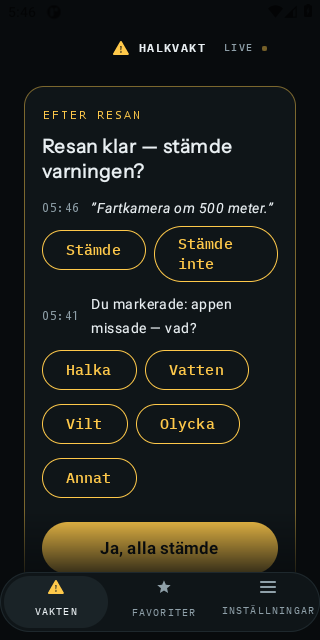 | 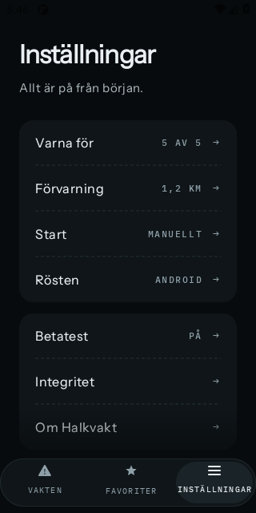 | 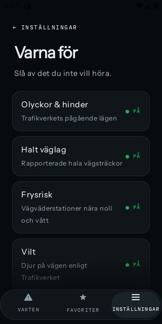 |

| Förvarning | Betatest | Om Halkvakt |
|---|---|---|
| 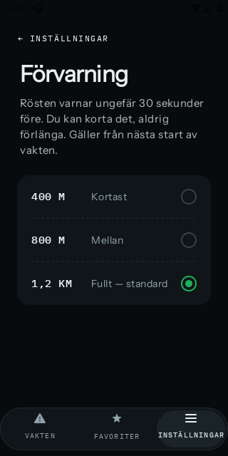 | 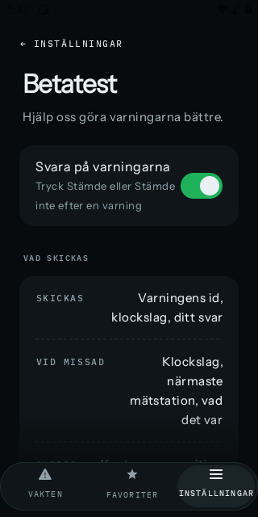 | 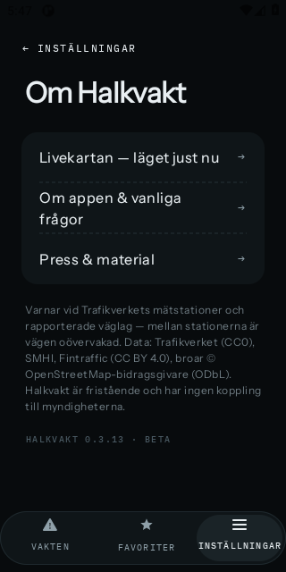 |

*(Android i skinnet v4 ur fotostudion 2/10, android.yml 37044258124 på grenen `design-v2-skinn` (PR #698) — betatestet påslaget,
en påhittad resa med en varning och en miss, så *Redo* visar kortet *Efter resan* överst. iOS-bilderna kommer ur första bygget i
Xcode: inget CI-flöde kompilerar iOS app-målet.)*

### Facitknappen (betatestet, S4 — Android 16/9)

| Efter resan: en varning och en miss | Betatest-brytaren i Inställningar |
|---|---|
|  |  |

*(Fotostudion 26/9, en påhittad resa: varningen *"Fartkamera om femhundra meter"* och en miss markerad fem minuter tidigare. Knapparna syns bara när betatestet är påslaget och varningen bär ett id; missen skickas först när ett av de fem valen är gjort.)*

## Skinnet (v4 — designöverlämningen v2, 2/10, kort #284)

Ritat om 2/10 (DECISIONS #444) och byggt samma kväll på **båda plattformarna, lika** — avviker Android från iOS är
det en bugg. Mörkt, tyst, Instrument Sans för text och IBM Plex Mono i versaler för etiketter, tal och avstånd.
**Gult betyder bara två saker:** en knapp som gör något, och varningen. **Grönt betyder på:** vippor, bockar, *PÅ*, *REDO*.
Logotypen är triangeln med utropstecknet urstansat; *v3*:s skinn (31/8) och dess ikoner är ersatta.

**Toppraden** bär logotypen i mitten och läget till höger med ett ljus som andas: *LIVE* med gult ljus när vakten väntar,
*PÅ* med grönt när den kör. **Tre flikar** i en flytande kapsel längst ner — *Vakten*, *Favoriter* och *Inställningar*
(*Favoriter* i mitten sedan 18/10, kort #357; 104 punkter per flik, så att tre ryms på en smal telefon). Ingen flikrad medan
vakten kör.

**01 Redo.** En 3D-sockel med logotypen, ordet *"Redo."*, raden *"Vakten vaknar själv när du kör. Din position lämnar
inte telefonen av sig själv."* (första meningen bara när vakten kan vakna själv), källorna i mono
(*HALKA · VILT · OLYCKOR · FRYSRISK · KAMEROR* — en avslagen källa står inte med), den gula knappen ▶ *Starta vakten* och
under den *INGEN TUR ÄN*.

**01b Redo efter tur.** Efter en tur med minst en varning byts sockeln mot ett **kvitto**: *SENASTE TUREN*, tiden och
sträckan (*16:58–17:34 · 36 MIN · 31 KM*) och en rad per varning — klockslag, ikon, rubrik och exakt vad rösten sa.
Under: *3 VARNINGAR · VISAS TILLS NÄSTA TUR*. En tur utan varningar ger tillbaka 01.
**Betatestare** ser dessutom kortet *Efter resan* överst, som förut (kort #203) — designen visar det inte, men det står kvar.
**Spara resan?** (18/10, kort #357) Har föraren slagit på *Erbjud att spara resor* under Favoriter står frågan som en
egen panel efter resan: *SPARA RESAN?* och *"Resan slutade 14:05. Spara vägen du körde, så finns den under Favoriter. Den
stannar i telefonen."*, tre namnknappar — *Till jobbet*, *Hem* och *Resa 18/10* (dagens datum) — *EGET NAMN* för fritext och
*NEJ TACK* (på Android två namnknappar per rad, som missraderna). Med fem sparade resor står i stället *"Du har redan fem resor. Ta bort en under Favoriter först."* Frågan kommer
bara efter en resa på minst två kilometer och fem minuter (DECISIONS #701), och utan svar försvinner den och vägen efter ett dygn (DECISIONS #616, #625).

**02 På vakt.** En panel med *● PÅ VAKT* i grönt, minuter och kilometer i stort, och tre räknare (varningar, halka,
vilt). Under den en streckad ruta: *"Tyst så länge — Inget på din väg än. Du hör det direkt när något dyker upp."*,
eller *Senast sagt · HH:MM* med repliken när rösten har talat. Sedan *PÅ DIN VÄG* med de tre närmaste farorna (ikon,
avstånd, fara, väg) och vägdatans klockslag till höger om rubriken. Längst ner *APPEN MISSADE NÅGOT* (betatestare) och
den neutrala knappen *Avsluta vakten*. Håll fingret på *PÅ VAKT* en halv sekund så visas kort B, halkkortet, med
motorns riktiga replik — så att granskaren ser ett varningskort utan att köra.

**Gammal väglagsdata.** När vägdatan är för gammal varnar appen inte för halka eller frysrisk på den. Sedan 20/10 säger
den inte heller något om det (DECISIONS #647): ingen röstrad, ingen mörk rad överst, inget kort. Det som skiljer är att
*Tyst så länge* inte visas, eftersom appen aldrig får tala lugnt på gammal data, och att väglagets klockslag står kvar
under *På din väg*. Ljuset förblir grönt; vakten är på.

**Varningskortet** — helgult i åtta sekunder medan rösten talar, sedan bort av sig självt. **Ingen knapp på någon
plattform** (Androids *Uppfattat* är borta). Samma ordning varje gång: *HALKVAKT VARNAR* och klockslaget, för allvarliga
olyckor en mörk lägesetikett (*ALLVARLIG · TIDIGT*, *PÅMINNELSE*, *ALLVARLIG · SENT*) och *BETA* för frysrisken efter regnet, farans ikon, rubriken, avståndet,
eventuellt en vägskylt (*E18*, *VÄG 25*) och en hastighetsskylt (*80*), för allvarliga olyckor en mörk rådruta
(*Överväg annan väg* med *STOR PÅVERKAN · RÖJD CA 19:30*, eller *Sakta ner*), repliken ordagrant och en stapel som fylls.
**Kortet visar det rösten sa och inget mer:** under en kilometer i hela hundratal (*500 M*, *600 M*), annars hela
kilometer (*3 KM*), och för halka, vilt och väderstationer ord i stället för tal (*FRAMFÖR DIG*, *FRAMÖVER*). Talet står
still i åtta sekunder. Kommer en viktigare fara inom tio sekunder glider ett nytt kort upp och täcker det gamla, som
krymper och tonar bort; stapeln börjar om.

| Kort | Rubrik | Avstånd | Extra |
|---|---|---|---|
| Olycka | *Olycka* | *3 KM* | vägskylt när Trafikverket anger väg |
| Allvarlig olycka, tidigt rop | *Allvarlig olycka* | *8 KM* | *ALLVARLIG · TIDIGT*, vägskylt, *Överväg annan väg* (+ röjningstid) |
| Allvarlig olycka, påminnelse | *Sakta ner* — *Olycksplats strax framför dig* | *STRAX FRAMFÖR* | *PÅMINNELSE* |
| Allvarlig olycka, sent | *Allvarlig olycka* | *2 KM* | *ALLVARLIG · SENT*, vägskylt, *Sakta ner* |
| Halka | *Halka* | *FRAMFÖR DIG* | — |
| Frysrisk vid station | *Frysrisk* — *Vägbanan nära noll grader* | *FRAMÖVER* | — |
| Frysrisk efter regnet (beta, S3) | *Frysrisk* — *Halkvakt tror — efter regnet* | *FRAMÖVER* | *BETA* |
| Halka enligt kandidaten (beta, nivå 2) | *Halka* — *Halkvakt tror — modellerat* | *FRAMÖVER* | *BETA*, halkans ikon |
| Frysrisk på bro | *Frysrisk* — *Bro* | *600 M* (hundratal, som rösten) | egen ikon |
| Vilt | *Vilt* | *FRAMÖVER* | — |
| Fartkamera | *Fartkamera* | *500 M* | hastighetsskylt när gränsen är känd |

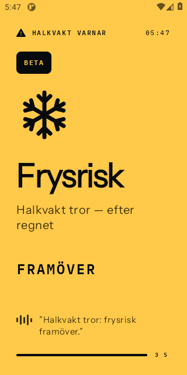

*(Betakortet, frysrisken efter regnet (S3): Android ur fotostudion 11/10, android.yml 38123089310 på grenen `claude/granskning-fotostudio-525`, en påhittad varning 655 m bort, bara i debug-bygget (DECISIONS #525). iOS-kortet har samma rader (`WarningCardTests.testPostRainBetaIsMarked`), men ingen skärmbild.)*

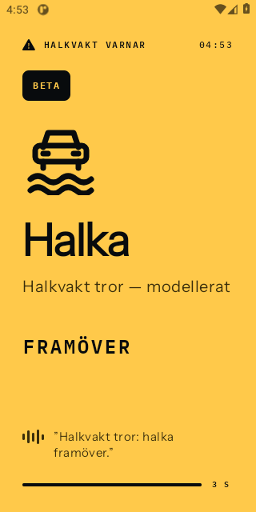

*(Kandidatens betakort: Android ur fotostudion 16/10, android.yml 38852518205 på grenen `claude/kandidat-farotyp-577`, en påhittad varning
655 m bort, bara i debug-bygget (DECISIONS #577). iOS-kortet har samma rader (`WarningCardTests.testCandidateBetaIsMarked`), men ingen
skärmbild.)*

Kortets innehåll räknas i motorpaketen (`WarningCard` i Swift och Kotlin) och prövas av CI med samma fall på båda
plattformarna; olycksläget kommer ur motorn (`Alert.step`, DECISIONS #443).

**Ikonerna:** sex, en linjetjocklek, rundade ändar: *olycka* (en avspärrningsbock), *halka* (bilen bakifrån med två
slirspår), *frysrisk* (en snöflinga), *bro* (en valvbro med en liten flinga — ny), *vilt* (en älg, den enda fyllda formen)
och *fartkamera* (en låda på stolpe med blixtlinjer). Svarta på kortet, ljusa i listorna.

**Inställningar i två nivåer.** Överst *"Inställningar — Allt är på från början."* och två paneler med rader som
öppnar en egen sida (som glider in från höger, med *← INSTÄLLNINGAR* för att gå tillbaka):
- *Varna för* (*5 AV 5*) — fem rutor, tryck var som helst för att slå av och på: grön prick *PÅ*, grå *AV*.
- *Förvarning* (*1,2 KM*) — tre val: *400 m Kortast*, *800 m Mellan*, *1,2 km Fullt — standard*. *"Rösten varnar ungefär
  30 sekunder före. Du kan korta det, aldrig förlänga."* (Det steglösa reglaget är borta.)
- *Start* (*SJÄLV*) — vippan *Vaknar själv när du kör*, *ELLER SÄG "Hej Siri, starta Halkvakt"* och
  *STOPPAR SJÄLV EFTER 15 MIN PARKERAD*. På iOS dessutom *Starta med Genvägar (valfritt)* i två spår — med CarPlay eller
  Bluetooth, och utan (fokus *Kör*) — fyra steg vardera, knappen *Öppna Genvägar* och, när en automation har startat
  vakten, *FUNGERAR — STARTAD SENAST …*. (Den gamla guiden med frågan om bilkopplingen är borta.)
- *Rösten* — var rösten byts i systemet och den gula knappen *Testa rösten*, som säger en riktig motorreplik:
  *"Fartkamera om 500 meter. Gränsen är 80."* Under den länken *TESTA I BAKGRUNDEN (TALAR OM 5 S)*: samma replik efter fem
  sekunder, så man hinner gå till hemskärmen och höra att rösten hörs i bakgrunden (Apple 2.5.4, DECISIONS #460).
- *Betatest* (*PÅ/AV*) — vippan *Svara på varningarna* och kvittot *VAD SKICKAS*: *Skickas* varningens id, klockslag,
  ditt svar · *Vid missad* klockslag, närmaste mätstation, vad det var · *Aldrig* konto, resa, position. *"Ett varnings-id
  pekar på en fara på kartan, så vi ser ungefär var du var just då. Appens namn och version följer med. Bara för
  betatestare."*
- *Integritet* — löftet: *"Din position lämnar inte telefonen av sig själv."* och *"All matchning mot vägdata sker lokalt
  i appen. Inget konto. Undantaget är betatestet — bara om du själv slår på det."* (i App Store-versionen från (33): *"Inget
  konto, och inget skickas."*, #681), sedan *"Slår du på Erbjud att spara
  resor under Favoriter sparas vägarna du väljer, bara i telefonen och aldrig i en säkerhetskopia. Du tar bort dem där."*
  (18/10; *"ingen spårning"* ströks, för en sparad resa är ett spår, även om det bara finns hos föraren, #616),
  raden till Betatest och Integritetspolicyn.
- *Visa introduktionen igen* (iOS).
- *Om Halkvakt* — Livekartan, Om appen & vanliga frågor, Press & material, ärlighetsraden och attributionen
  (oförändrade), och versionen.

Under panelerna: *LÖFTET — Din position lämnar inte telefonen av sig själv.*

## Favoriter (18/10, kort #357 — steg 2 och 3)

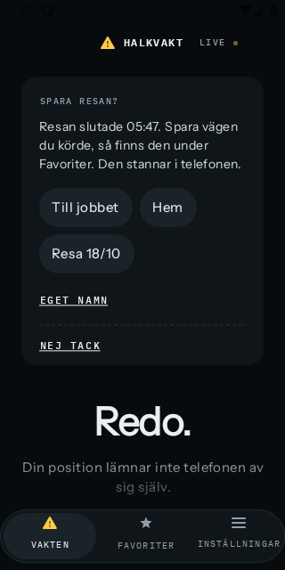 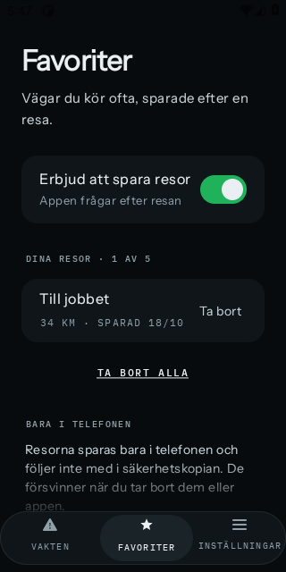 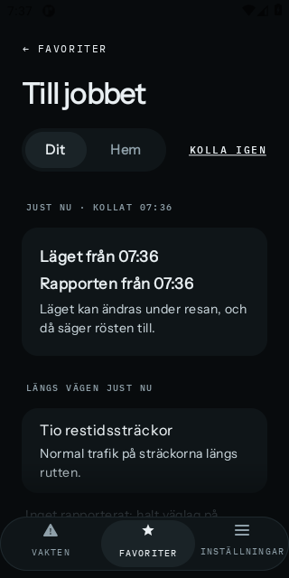

*Fotostudion (Android-emulatorn) med påhittade vägar ur kroken `fotostudio_favoriter`; läget och rapporten ur den riktiga rapportfilen och lägesfilen när bilden togs (android 39113957298). Klockslagen är emulatorns, i UTC.*

Den mittersta fliken. Överst *"Favoriter — Vägar du kör ofta, sparade efter en resa."* och vippan **Erbjud att spara resor**
(*Appen frågar efter resan*), **av från början**. Av: ingen väg samlas in och ingen fil skrivs — appen är som förut, och
texten säger *"Slå på, så frågar appen efter en resa om du vill spara vägen du körde. Högst fem resor."* På och inga resor:
*"Kör en resa, så frågar appen efteråt om du vill spara den."* Med resor: *DINA RESOR · 2 AV 5* och en rad per resa med
namnet och *34 KM · SPARAD 18/10*, knappen *Ta bort* på varje rad och *TA BORT ALLA* under, som frågar en gång till. Sist
*BARA I TELEFONEN — "Resorna sparas bara i telefonen och följer inte med i säkerhetskopian. De försvinner när du tar bort
dem eller appen."* Sparade resor står kvar i listan också om vippan slås av; den som vill bli av med dem tar bort dem.

**Hur det fungerar.** Under resan glesas positionerna till en punkt per 75 meter (motorns `Ruttinsamlare`, samma regel i
tre språk, `engine/fixtures/rutter.json`). När vakten stoppar läggs vägen i en tillfällig fil tills föraren svarat på
*Redo.* (se 01b ovan), högst ett dygn. Båda filerna ligger i telefonen och följer aldrig med i en säkerhetskopia: på iPhone under
Application Support, undantagna från iCloud-kopian; på Android i `noBackupFilesDir`, och en egen regel
(`res/xml/data_extraction_rules.xml`) stänger ute dem när appen flyttas till en ny telefon. Ingen kod som når nätet rör dem, och ingen karta ritas bakom vägen (ruttspärren i ci,
`scripts/rutterspar.ts`).

**Läget och rapporten (steg 3b på iPhone, 18/10; DECISIONS #636, #637).** Under namnet på varje rad står resans läge (FAVORITER §2): **Nytt** med ett gult märke — *2 NYA* — och det viktigaste av det nya, till exempel *Olycka på E4*; **Inget nytt** med det största som pågår — *Inget nytt · Halt väglag på E4*; eller **Lugnt** — *Lugnt · inget rapporterat längs vägen just nu*. Fartkamerorna och restidssträckorna i normal trafik räknas inte: de är inga händelser (en restid med fördröjning är en kö och räknas). Läget räknas om när fliken visas och när föraren drar nedåt. Ett tryck på raden öppnar **rapporten**: tillbakalänken *← FAVORITER*, resans namn och valet **Dit / Hem** — samma sparade väg åt två håll, där *Hem* är den vända, så att farorna kommer i körordning och köerna och restiderna gäller förarens håll. Sedan *JUST NU · KOLLAT 07:05* med *Läget från 07:00* och *"Läget kan ändras under resan, och då säger rösten till."*; *NYTT SEDAN 16:20* (i gult, *i går 16:20* dagen efter) med det som tillkommit sedan rapporten senast öppnades; *LÄNGS VÄGEN JUST NU* med en rad per sak i viktordning, där fartkamerorna läggs samman per väg, restiderna i normal trafik till en rad och vägarbeten, hastigheter och omledningar per väg från tre; raden om det tomma — *"Inget rapporterat: vilt, färjor och SMHI-varningar."* och *"Köer mäts inte längs den här vägen."* där ingen restidssträcka går; *PROGNOSEN · KOMMER SENARE* med *"Prognosen längs vägen visas här tidigast efter domen i mars."*; och sist *Starta vakten*. Trafikverkets *Vägen avstängd* heter *Avstängning* i rapporten, med vägen när den finns (*Avstängning på E45*), och för vägarbeten, olyckor och hinder står Trafikverkets påverkan i texten — *"Drift- och underhållsarbete. Tunneln avstängd under arbetet. · ingen påverkan enligt Trafikverket · till 19 oktober"* (DECISIONS #641). Inga avstånd på raderna. Är lägesfilen 45 minuter eller äldre visas inte väglag och frysrisk, och är rapportfilen två timmar eller äldre visas inte olyckor och vilt — samma gränser som rösten — och rapporten säger det i gult. Med Betatest av, och alltid i App Store-versionen från (33), räknas frysrisken efter regn (S3) inte fram i rapporten, precis som rösten tiger om den (#679, #681). Rapporten visar i dag bara lägesfilens tid; rapportfilens tid, *Rapporten från HH:MM*, kommer i bygget efter (33) (#686).

Appen hämtar rapportfilen ur den publika hinken `favoriter` (samma fil för alla, utan fråga och utan plats; manifestets sha256 prövas, och en del som inte stämmer förkastas) och räknar rapporten i telefonen med motorns `ResansRapport`. Förra kollen per resa — när rapporten öppnades och vilka faror den visade — ligger i `kollen.json` bredvid rutterna, utanför säkerhetskopian, eftersom farornas id pekar på platser längs vägen. **Vägen hem känns igen:** ligger en ny resa längs en sparad, åt något håll (minst 80 % av varje inom 100 m av den andra), frågar appen inte *Spara resan?* en gång till. **Android (steg 3c, 18/10)** gör samma sak med samma ord: rapporten öppnas en nivå ned, som inställningarnas undersidor, och tillbakaknappen leder till listan. I stället för att dra nedåt finns *KOLLA IGEN* bredvid *Dit / Hem* — appens Compose-version saknar dra-för-att-uppdatera — och läget räknas om varje gång fliken eller rapporten visas. Förra kollen ligger i `noBackupFilesDir` med rutterna.

## Första gången — introduktionen (iOS)

Fyra sidor med punkter längst ner, *HOPPA ÖVER* till vänster och *NÄSTA* / *KLAR* till höger. Allt går att hoppa över och
ändra senare. Toppraden säger *VAKEN* med gult ljus tills platsen är *Alltid*, sedan *PÅ* med grönt.

1. **Löftet** — logotypen stort, *"Varnar med rösten"*, *"Halka, olyckor, frysrisk, vilt och fartkameror från
   Trafikverket — i din högtalare, innan du är där."*, sockeln med logotypen, rutan *LÖFTET — "Din position lämnar inte
   telefonen av sig själv."* med raden *"Sparar du resor som favoriter stannar de också i telefonen."* (18/10) och *Testa rösten* (som säger *"Fartkamera om 500 meter. Gränsen är 80."*).
2. **Platsen** — *"Platsen — bara i telefonen"*, *"Välj Alltid så kan vakten starta själv när du kör."* och en kartnål på
   sockeln. *Fortsätt* → iOS egen fråga; sedan den gröna *Fortsätt* → iOS fråga om Alltid (Apple 5.1.1(iv), DECISIONS #460). Med Alltid: en grön bock och *"Alltid —
   vakten vaknar själv när du kör"*, ringarna blir gröna. Avböjer du Alltid: *"Bara när appen är öppen — vakten startar
   inte själv"* och *ÄNDRA TILL ALLTID*. Nekar du: nålen blir grå, *PLATS · AV — "Utan plats vet vakten inte vad som
   ligger framför dig."* och *Öppna Inställningar*.
   **iOS egen ruta** säger (ordagrant, `project.yml`): *"Halkvakt jämför din position med
   vägfaror lokalt i telefonen och varnar med rösten, även med släckt skärm under körning.
   Ingen position lämnar telefonen av sig själv — det enda som skickas är betatestets
   facitsvar, som du själv slår på."* Och vid *Alltid*: *"Med "Alltid" startar vakten av sig
   själv när du börjar köra. Matchningen sker lokalt i telefonen — ingen position lämnar den
   av sig själv."*
3. **Bannern** — *"Bannern över kartappen"*, *"Kör du med Google Maps eller Kartor visas rösten som en banner i åtta
   sekunder."*, en svävande exempelbanner över en liten karta (*FARTKAMERA · 500 M — "Fartkamera om 500 meter. Gränsen är
   80."*) och *Tillåt notiser*. Påslagna: *Notiser på*. Avslagna: bannern bleknar, *"Rösten varnar ändå — bara utan
   banner."* och *SLÅ PÅ I INSTÄLLNINGAR*.
4. **Du är klar** — ett kvitto, inte en manual: *KVITTO* och dagens datum, *START* (*Själv när du kör* / *När appen är
   öppen* / *Plats saknas*), *DIREKT "Hej Siri, starta Halkvakt"*, *STOPP Efter 15 min parkerad*, *BANNER På* eller *Av —
   bara röst*, och *STATUS*: *REDO* i grönt, eller *REDO · UTAN BANNER*, *BEGRÄNSAD*, *EJ REDO*. Saknas något:
   *ÅTGÄRDA I INSTÄLLNINGAR*, som går tillbaka till rätt sida; annars *ALLT GÅR ATT ÄNDRA I INSTÄLLNINGAR*.

Inga konton, ingen e-post, inga fler frågor.

*(Android har ingen introduktion än — designens fyra sidor är inte byggda där. Första trycket på Starta ber om plats och,
på Android 13 och senare, notiser; vippan *Vaknar själv när du kör* under Inställningar → Start ber om resten:
rörelseigenkänning, Bluetooth och plats "Tillåt hela tiden".)*

## Exakt vad rösten säger

| När | Frasen |
|---|---|
| Lindrig olycka framför dig | "Olycka rapporterad **på väg 25**, 3 kilometer framför dig." |
| Bro nära frysande station (0.3.3) | "Frysrisk framöver — bro om 700 meter." |
| **Allvarlig olycka — tidigt ropet, ca 10 km** | "Allvarlig olycka **på E18**, 10 kilometer framför dig — stor påverkan på trafiken. Överväg annan väg. Beräknas röjd vid 14:20." |
| **Allvarlig olycka — påminnelsen, ca 2 km** | "Sakta ner — olycksplats strax framför dig." |
| **Allvarlig olycka du kom nära utan att höra det tidiga ropet** | "Allvarlig olycka 2 kilometer framför dig — stor påverkan. Sakta ner." |
| Rapporterad halka på din väg — kod 2 eller högre, eller kod 1 med is, snö, frost, halka, halt, halkrisk, halkig eller *mycket besvärligt* (det sista sedan 22/9, kort #156; sedan 16/9 även i sammansättningar: *Rimfrost*, *Nysnö*, *Blötsnö*; motåtgärder som *Halkbekämpning* tiger) | "Varning: halka rapporterad på vägen framför dig." |
| Mätstation visar frysrisk | "Isrisk framöver — vägbanan nära noll grader." |
| **Efter regnet, märkt beta (S3):** ytan +1…+3 °C, fallit minst 0,8 °C på 30 minuter och regn inom 2 timmar — vägbanan är fortfarande över fryspunkten men på väg ned (DECISIONS #222, #524) | "Halkvakt tror: frysrisk framöver." |
| **Halka enligt kandidaten, märkt beta (nivå 2):** modellens vägyta 0 °C eller kallare och ett mätt fuktbesked — Trafikverkets *Våt* på sträckan eller nederbörd på radarn — ingen varm station inom 15 km och stationerna runt omkring överens; en gång per sträcka och högst en gång per 10 minuter (DECISIONS #562–#577, #606) | "Halkvakt tror: halka framöver." |
| Djur på vägen enligt Trafikverket — älg, hjort, vildsvin, men också lösa kor och får (sedan 22/9, DECISIONS #318; polisens länspunkter är borta) | "Viltrisk framöver." |
| Fartkamera (hastighetsgränsen sägs inte: Trafikverkets kameradata bär ingen) | "Fartkamera om 500 meter." |

**Frysrisken efter regnet är en beta.** *"Halkvakt tror"* säger att det är en gissning ur regnet och hur fort vägbanan kyls, inte
en uppmätt frysning. Värdena är satta före frosten och döms i januari på förarnas svar: håller de fortsätter betan till mars,
annars tas den bort (TROSKLAR-KOMBINATIONEN §7). Testförarna får veta att värdena är gissade.

**Halkan som kandidaten tror på är också en beta.** Den räknas ur en vädermodell vid punkter ungefär varannan kilometer längs
vägen, inte ur en mätning på platsen — därför *"Halkvakt tror"* och aldrig ett avstånd. Den talar sist av alla varningar: allt annat
går före, och den kan aldrig tysta en annan varning. Har Trafikverkets halkvarning för samma sträcka just hörts tiger den i två
minuter, så att samma besked inte kommer två gånger i rad, och den talar högst en gång per 10 minuter, vilken sträcka det än gäller (DECISIONS #606). Den följer reglaget *Halka* i *Varna för* och tystnar när väglagsdatan är äldre
än 45 minuter. Domen faller i mars (DECISIONS #547); den kan stängas av från servern utan ett nytt bygge, och det provas före App
Review (NIVA2-LIVE steg 13).

**Allvarlig olycka — varför två gånger?** Trafikverket klassar varje olycka efter
hur mycket den påverkar trafiken. Är påverkan *mycket* stor — riktigt stopp — säger
Halkvakt till *tidigt*,
runt en mil innan, medan det fortfarande finns avfarter kvar att välja. Det är
hela poängen: du ska hinna bestämma dig innan du sitter fast. Sedan kommer en
kort påminnelse strax innan olycksplatsen, som bara handlar om farten.
Röjningstiden läses upp när Trafikverket angett en.

**Rösten säger VAR (2/9):** vägnumret följer med i olycksfrasen — *"på E18"*, eller *"på
väg 25"* när numret saknar bokstav, så talsyntesen inte säger "olycka på 25". Saknar
Trafikverket vägnummer är frasen som förr. Bara olyckor: halka och frysrisk gäller
sträckan du redan kör på, och där tillför "på E4" inget.
Halkvakt räknar **aldrig** ut omvägen åt dig — det gör din kartapp. Vi levererar
beslutet i tid, du väljer vägen. Inga knappar att trycka på under körning.

**Röstens uppförandekod:** samma fara upprepas först efter 10 minuter *och* 5 km (enda
undantaget är den allvarliga olyckans två steg ovan, som är två olika budskap); står två
faror samtidigt framför dig vinner den allvarligaste (olycka > halka > frysrisk > vilt >
kamera) och den andra **droppas** — köas aldrig upp till tjat. Under 15 km/h: tyst.

**Spärren mellan varningar (ändrad 13/9):** minst 10 sekunder mellan två varningar av
samma eller lägre tyngd — men **en viktigare fara får bryta spärren**. Förr var spärren
45 sekunder och blind: en fartkamera kunde tysta isen som kom 20 sekunder senare, och när
spärren öppnade var isen 61 meter bort. Nu får is avbryta en kamera; en kamera kan aldrig
avbryta is. Tio sekunder är räknat ur att två fartkameror i samma riktning aldrig ligger
närmare än 520 meter — så en kamera kan aldrig tystas av golvet.

**Och en sak Halkvakt medvetet INTE gör (Bengts fältdom 12/9):** dämpar inte sanna
varningar som upprepas. Kör du åtta mil på is säger rösten *"halka"* var tionde minut, för
det ÄR halt. "Cry wolf" handlar om falska varningar — det är falskheten som äter
förtroendet, inte upprepningen. Mot uppmärksamhetsförfall under två monotona timmar är
upprepning rätt design.

**Halkzonen (ändrad 17/10, DECISIONS #621, #624):** halksträckor som möts eller ligger tätt —
linjerna inom 500 meter från varandra — räknas som **en** zon för uppförandekoden. I en
korsning där tre sträckor med halka möts säger rösten *"halka"* en gång, inte tre gånger på
en och en halv minut (soffprovet vid Vittangi 17/10). Inne i zonen gäller samma regel som på
en lång sträcka: *"halka"* igen efter 10 minuter och 5 km, så åtta mil is fortfarande
påminner var tionde minut. Två sträckor med halka som ligger långt isär talar var för sig,
som förut. Rösttexten är densamma.

## Broarna (0.3.3)

Broar fryser före vägen. Halkvakt känner till varje bro på riks- och europavägarna (ur
OpenStreetMap) och säger till när närmaste vägväderstation ligger nära noll och det är
vått: *"Frysrisk framöver — bro om sjuhundra meter."* Tröskeln för bron är +3 grader,
högre än vägens +1, för att brobanan kyls från två håll. Det är en mätning plus ett
faktum — ingen prognos. Är stationen varmare än tre grader tiger vakten om bron.
2 476 broar ligger i publiceringen (OpenStreetMap, ODbL). Snapshoten till telefonen bär bara de broar
vars närmaste station inom 15 km är +3 grader eller kallare och våt — så länge ingen station är nära noll
är listan tom.

## Flöde 1 — en körning

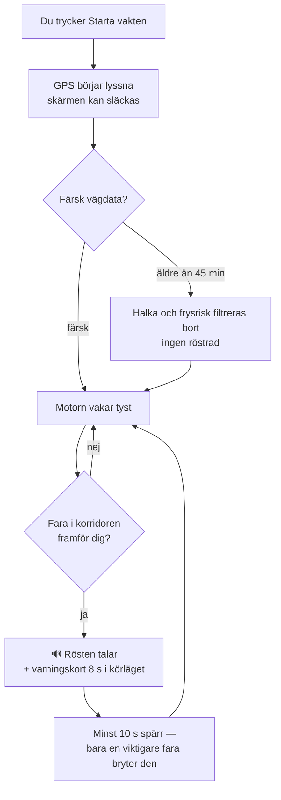

## Flöde 2 — datans väg till din högtalare

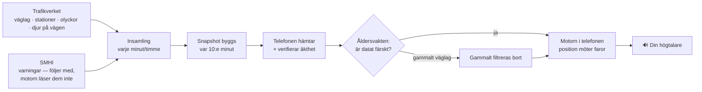

Under resan hämtar telefonen ny vägdata var 30:e minut och prövar den mot åldersvakten igen. Utan nät gäller den senast
verifierade, och den åldras likadant: väglaget faller bort efter 45 minuter, olyckor och djur efter två timmar. Android har
gjort så från början; iPhone från 0.3.9 (16) — innan dess laddade den bara när vakten startade (kort #258).

Allt till höger om "Telefonen hämtar" sker **lokalt i din telefon** — därav
löftet: positionen möter faroläget hos dig, aldrig hos oss. SMHI:s varningar följer med i snapshoten
men motorn läser dem inte: rösten talar aldrig på en SMHI-varning. De mäts i skuggan (förstärkaren F nedan).

**Sedan 8/9 går hela kedjan utanför GitHub.** Insamling varje minut, snapshot var tionde,
kartsajt var trettionde — allt i Supabase. Det hände efter att appen serverat tre dygn
gammal data när en byggkvot tog slut. Åldersvakten höll: rösten sa *"Ingen färsk
väglagsdata"* i stället för att hitta på. Men den hade inget att säga. Nu finns dessutom en
vakthund som varje timme kontrollerar att datan faktiskt når telefonen — inte bara att den
ligger på servern. Skillnaden lät liten. Den var tre dygn.

**Fyra länder (31/8, Norge sedan 22/9):** Finland (Fintraffic), Norge (Vegvesen) och Danmark (DMI) hämtas
löpande. Kör du E8, E10, E12 eller E14 mot gränsen ser motorn de finska och norska stationerna inom 40 km
av svenska vägar — frysrisken slutar inte vid gränsen. De danska stationerna följer inte med: rösten säger
inget om frysrisk i Danmark ännu, det väntar på beslut.

## Hur vi vet att rösten har rätt — mätapparaten

Halkvakt gissar inte. Varje fara rösten talar om, och varje fara den *inte* talar om, ska
kunna bevisas mot verkligheten. Det är det som skiljer appen från en som säger "det kan
vara halt" när det är kallt. Här är hur det går till.

### Principen: trösklar före mätning, dom efter

```mermaid
flowchart LR
    F[Fråga<br/>"kan X bära en varning?"] --> T[Tröskeldokument<br/>vad som krävs för JA<br/>skrivs INNAN mätning]
    T --> S[Signaturer<br/>Bengt fastställer<br/>Axel kontrasignerar]
    S --> M[Mätning<br/>mot facit, i skugga<br/>rösten rörs inte]
    M --> D{Dom}
    D -- klarar --> R[Rösten får säga det<br/>nästa app-version]
    D -- faller --> N[Dokumenterat nej<br/>kortet stängs]
    D -- för lite data --> O[OAVGJORT<br/>väntar på vinter]
    style T fill:#FFC94A,color:#140F00
    style D fill:#1FB25A,color:#fff
```

Det viktiga är ordningen. **Trösklarna skrivs innan någon vet hur talen ser ut.** Det är det
enda som gör att en dom går att lita på — och det enda som gör att ett nej inte kan
förhandlas bort i efterhand. Grind A skrevs den 1 september på 57 mätpunkter och dömdes den 23 september
på 7 356 — klarad. Den 12 september såg den ut att falla, tills det visade sig att mätningen saknade vakterna
mot trasiga givare; med dem stod det INGEN DOM samma dag. Ingen flyttade målstolparna, för de var daterade.

En dom har tre utfall, aldrig två. **OAVGJORT** är ett riktigt svar: instrumentet vägrar
döma under ett minsta underlag (till exempel 500 punkter över 20 stationer) och skriver
det ut i stället för ett tal. Det skyddar mot att döma på urvalsfel — i september är
nästan alla kalla mätningar från samma tre stationer.

### Grindarna — vad som mäts, hur, och var det står

| Grind | Frågan | Måttet | Facit | Läge 24/9 |
|---|---|---|---|---|
| **A — Skuggmotorn** | Kan en stations yttemp förutsägas ur grannarnas? | MAE ≤ 1,0 °C · grova fel ≤ 5 % · frysklassfel ≤ 10 % | Stationen själv, leave-one-out | **KLARAD** 23/9: 0,71 °C, grova fel 3,5 %, frysklassfel 0,0 % på 7 356 punkter (DECISIONS #321). Vägpunkten utan egen historik: grinden öppen (#324) |
| **Frysklassningen** | Kan en modell dålig på grader ändå bära *vilken sida av noll*? | Egna trösklar, skrivna före mätning | Samma leave-one-out | Körd 24/9: **INGEN DOM** — ingen station har frusit vid nollgränsen på 60 dygn |
| **V — Vattenplaning** | Kan stationsregn förutsäga intensitet där du kör? | Träff ≥ 70 % · falsklarm ≤ 20 % | Radar + olyckor | **NEJ** (61 % på 3 594 punkter). Stationsspåret nedlagt. Radarspåret (V-B) mäts i skuggan sedan 15/9 och döms när V-C:s underlag räcker (DECISIONS #191, #350) |
| **Radardomen** | Duger radarn som segmentkälla för regn? | Bekräftelse mot station per intensitetsband | Stationerna | Prövas i mars ur arkivet; betan kör utan radar (DECISIONS #223) |
| **T — Trenden** | Varnar "ytan faller mot noll" i tid? | T-A fysik (klara nätter) · T-B träff/miss/falsklarm | Omklassning till halka, kameror | **OAVGJORT** — steg 0 körd 24/9: 47 frostnätter på 26 stationer, ingen separation än. Körs om av sig själv vid första frosten |
| **Ö — Övergångarna** | Fryser en blöt väg efter regnet som slutat? | B3-paret: räddade missar mot tillkomna falsklarm, per proxy | Omklassning, kameror, olyckor | Ö-A passerad (hålet finns: 35 min, inte 10). Skattaren med nivå och bevis byggd 24/9. Ö-B väntar på frost |
| **W — Vind och sikt** | Är byvind/sikt en egen fara, eller förvärrar de halka? | Två roller, dömda var för sig | Olyckor per exponeringsband | **OAVGJORT** — steg 0 körd 24/9, underlaget räcker inte än |
| **F — SMHI-förstärkaren** | Höjer en snövarning konfidensen? | Golv OCH tak (5–80 %) | Omklassning | **OAVGJORT** — 3 stationstimmar (13/9) |
| **Rimfrost** | Svartis utan nederbörd, yta under daggpunkt? | Andra gren i frysrisken, inte sjätte fara | Finska arkivet, Lapplands septemberfrost | Fastställd 12/9. Körd 24/9: 0 episoder, **OAVGJORT** |
| **Tystnadsfelet** | Hur ofta tiger rösten när den borde tala? | Oursäktlig miss (signal fanns) mot ursäktlig | Hela facitstacken | Instrumentet byggt 24/9 (DECISIONS #330); dom när halkperioderna finns |
| **Väglagets ålder** | Ska ett stående "Is och snö" tystas när vintern tagit slut? | Världen motsäger klassningen, inte ålder | Stationer mot segment | Fastställd 12/9. INGEN åldersgräns byggd |

Trösklarna ligger i `docs/TROSKLAR-*.md`, elva dokument. Tre kort stängdes som dokumenterade nej på de
första två veckorna: vattenplaningens stationsspår, dämpningen, och däcktyp. Ett nej som skrivs ner
är värt lika mycket som ett ja — det hindrar att samma idé kommer tillbaka om tre veckor.

### Instrumenten — vad som mäter vad

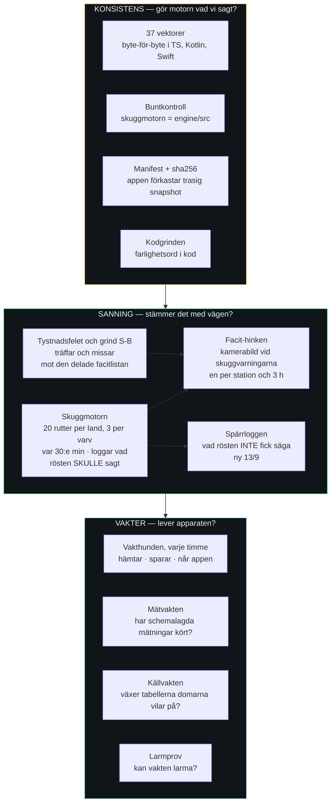

**Konsistensvakterna** svarar på om motorn gör vad vi sagt. De 37 vektorerna är den
viktigaste: en fil per scenario med spår, faror och exakt förväntad röstlogg, och alla
tre motorerna — TypeScript, Kotlin, Swift — måste ge samma svar byte för byte. Ändras en
regel måste vektorn ändras med, synligt, i samma commit. De kan köras i augusti.

**Sanningsvakterna** svarar på om det motorn säger stämmer med vägen. De kräver facit,
och facit finns bara på vintern. Skuggmotorn kör referensrutter var trettionde minut mot
riktig data och loggar vad rösten *skulle* ha sagt — utan att någon förare hör det.
Facit-hinken arkiverar en kamerabild från Trafikverkets väglagskameror vid
skuggvarningarna — en per station och tre timmar — så vi i mars kan öppna bilden och se: sa vi halka, och *var* det halt?

**Spärrloggen** är nyast. Det rösten inte fick säga — kastat av spärren — loggades
ingenstans förrän 13/9. Nu står det i skuggloggen: vad, tystat av vad, med vilken marginal.

**Vakterna** svarar på om apparaten själv lever. Vakthunden kollar varje timme att datan
hämtas, sparas *och når telefonen* — det sista ledet är det som gick sönder i tre dygn
utan att synas. Mätvakten kollar att de schemalagda mätningarna faktiskt kört; fyra låg
döda i fem dygn i september. Och larmprovet: en vakt som aldrig provats är ingen vakt.
Första gången vi provade kunde vakthunden bara säga "allt bra" — larmvägen gav 500.

### Vad mätningarna säger i dag

Det korta svaret: **motorn är bevisat konsekvent och oprövat sann.** Vektorerna bevisar
att den gör vad vi sagt. Ingen sanningsvakt har haft en enda vinterdag att mäta mot.
Grind A klarade sig på septemberdata 23/9 — men septemberdata är inte vinterdata. Trenden,
vinden, frysklassningen, rimfrosten och förstärkaren står alla på OAVGJORT av samma skäl:
för lite frost.

Det som gör oss lugna är att apparaten kunde säga nej till oss själva när den fick data.
Det som gör oss vaksamma är att tre gånger på två veckor verifierade vi att något *fanns*
i stället för att det *fungerade*. Instrumenten är byggda. Vintern är facit.

## Vad appen inte gör

Ingen prognos (varnar på uppmätt läge, inte gissningar), tyst mellan
mätstationerna, ingen ködetektion ännu. Skickar ingenting om
dig — med ett enda undantag som du själv slår på: betatestets facitsvar (se Om). Vägar du kört sparas bara om du slår på
det under Favoriter, och bara i telefonen. Hela ärliga
listan: [SYSTEM.md §4](SYSTEM.md).

## iOS-utgåvan (byggd 29/8 2026)

Samma tre flikar, samma röst, samma motor — skillnaderna står utskrivna ovan där de finns. Flikraden är
systemets egen (iOS 26 ritar den som svävande glas). Överst på Vakten och i körläget sitter varumärkesraden
**⚠ HALKVAKT** med statuspillen till höger: *Trafikverket live* i vila, *Vakten på* under körning.
Skärmbilder från iOS tas på Axels iPhone eller i simulatorn med fotostudio-kroken (CI:n fotar bara Android).

## Autostart i bilen

**Android:** slå på vippan *Vaknar själv när du kör* under Inställningar → *Start* (före skinnet v4, 2/10, var det brytaren *Autostart* på hemskärmen). Den ber om fyra behörigheter i tur och ordning:
plats, rörelseigenkänning, Bluetooth och plats *Tillåt hela tiden* (som Android 11 och senare bara ger i
inställningarna, kort #226). Sedan lär sig appen varje Bluetooth-enhet som kopplas medan vakten går — även
hörlurar — och startar vakten när en av dem kopplar upp igen. Rörelseigenkänningen startar vakten i bilar
utan Bluetooth. En vakt som startat av sig själv stannar när bilen kopplas från eller rörelseigenkänningen ser att du
lämnat bilen, och varje vakt stannar efter en kvart stilla, som på iPhone (kort #248, 24/9).

*Rättat 1/10 (kort #262 Å4):* brytarens undertext sa *"Startar när bilens Bluetooth kopplas"* — men rörelseigenkänningen är
huvudspåret och startar vakten i vilket fordon som helst, också som passagerare i en buss. Nu: *"Startar när telefonen märker att
du åker bil, direkt om bilens Bluetooth kopplas."* Beteendet är oförändrat; texten säger vad reglaget gör.

**Avsluta vakten från låsskärmen (1/10, kort #262 Å1):** den pågående notisen *Halkvakt aktiv* har knappen **Avsluta vakten** på
Android. Förut gick vakten bara att stoppa genom att öppna appen — Bengts fältrapport 27/9 visade en vakt som stod på i nästan tolv
timmar. Knappen gör samma sak som *Avsluta vakten* i appen, också för autostarten.

**iPhone — vakten vaknar själv (0.3.2):** ge Halkvakt platsen **Alltid**. Då ber appen iOS
väcka den när telefonen lämnar platsen där bilen senast stod (150 meter), följer farten i upp till en och en
halv minut och startar vakten vid 15 km/h. Första resan efter installation, när ingen parkering är känd,
väcks den i stället av iOS större platsbyten (Apple anger ungefär 500 meter). Kostar nästan inget batteri.
Inget mer att ställa in. Kan stängas av under Inställningar → *Vaknar själv när du kör*.

**Bevisat på pappas telefon 31/8** — vakten startade själv utan att han rörde telefonen,
och körläget visade fyra fartkameror sex kilometer fram. Sedan Malmö–Boden 1/9: 100 mil
med självväckningen som enda start.

**Resan håller ihop över pauser (0.3.3):** vakten somnar efter en kvart stilla och vaknar
när bilen rullar igen — men tid och sträcka nollas inte vid varje macka. Vaknar den inom
tre timmar fortsätter samma resa; pausen räknas bort från körtiden. Pappa hittade det: "vi
har kört 50 mil men mätaren står på 23,5." Den räknade rätt — bara sedan senaste pausen.

**Fartkamerorna varnar på rätt sida (0.3.5):** tre varv på samma bugg. Pappa: "den mäter
alltid mot kameran i motsatt färdriktning." Rotorsaken var att Trafikverkets riktning är
dit kameran *tittar* — rakt mot trafiken den fotograferar — inte åt vilket håll trafiken
kör. Vi läste den bakvänt sedan dag ett. Verifierat mot Öjersjö-kameran, ID 14102020:
"norrgående körriktning, bäring 158°". Nu vänd, och toleransen 60 grader.

**Vill du att den startar i första metern** finns två snabbare vägar: säg *"Hej Siri,
starta Halkvakt"*, eller bygg en automation i Genvägar en gång. Guiden — under Inställningar →
*Starta direkt (valfritt)* — ställer först **en fråga: hur kopplar du telefonen i bilen?** och
visar sedan bara de steg som gäller dig:

Knappen *Öppna Genvägar på Ny automation* kommer först och landar på listan över
utlösare. Sedan ett steg per skärm, med det du trycker på i fetstil:

- **CarPlay:** tryck *CarPlay* → bocka *Ansluts* → *Kör direkt* → skriv Halkvakt → *Starta
  vakten* → Klar. Startar när bilens skärm tänds.
- **Bluetooth:** tryck *Bluetooth* → din bil, *Är ansluten* → *Kör direkt* → skriv Halkvakt →
  *Starta vakten* → Klar. Startar när bilen vaknar, bara i din bil.
- **Inte alls:** två delar. Del 1 i Inställningar: *Fokus → Kör* (finns inte Kör i listan:
  *+ → Kör → Anpassa fokus*) → *Aktivera automatiskt → När du kör → Automatiskt*. Del 2 i Genvägar: tryck *Fokus → Kör* → bocka *Slås på* → *Kör direkt* → skriv
  Halkvakt → *Starta vakten* → Klar. Telefonen känner av körningen själv.

Knappen *Öppna Genvägar på Ny automation* i guiden landar direkt på rätt skärm. Går du
in i Genvägar själv: det är fliken **Automation längst ner i mitten** — inte + uppe till
höger på första fliken, det skapar en genväg, inte en automation. Utlösarna (CarPlay,
Bluetooth, Fokus, App) är en lista du scrollar i, inget man söker efter.

I alla tre: välj *Kör direkt* (inte *Fråga innan*). **Det räcker.** Vakten stoppar sig
själv när bilen stått still i en kvart. Svaret går att byta i Inställningar.

Ge Halkvakt platsen **"Alltid"** så startar vakten tyst i bakgrunden och kartan stannar
kvar på skärmen. Med "Vid användning" visas Halkvakt en kort stund vid starten och du
växlar tillbaka till kartan. Siri fungerar också: *"Starta Halkvakt"*. Appen lämnar
aldrig ifrån sig din position av sig själv — det gäller precis lika vid autostart.

## Bannern över kartappen

Kör du med Google Maps eller Apple Kartor framme ligger Halkvakt i bakgrunden. När
rösten varnar visas då en kort banner högst upp — samma ord som rösten säger — i åtta
sekunder, sedan försvinner den själv. Ingen knapp, inget att trycka på, inget ljud
utöver rösten. Bannern är ögats kvitto; rösten är budskapet.

Har du Halkvakt framme visas i stället varningskortet i appen. På iPhone bryter bannern
igenom Fokus-läget "Kör"; på Android bryter den inte igenom Stör ej. Telefonen frågar om notiser får
visas — på iPhone i introduktionen eller vid första starten, på Android första gången du trycker Starta.
Säg ja, annars uteblir bannern (rösten talar ändå).

## Senast sagt

Sedan skinnet v4 (2/10) lika på båda plattformarna: under körning står *Senast sagt · HH:MM* med repliken i den streckade
rutan i *På vakt* (*Tyst så länge* innan rösten har talat), och efter turen står varje replik i kvittot på *Redo* (01b)
tills nästa tur. Den gamla raden under knappen och Androids *Senast sagt* på hemskärmen är borta.

**Facitknappen (betatestet, 16/9):** för betatestare på Redo, under den senast sagda repliken, två knappar, *Stämde* och *Stämde inte*.
Ingen fritext — inte i en bil. Svaret sparas i telefonen och skickas när bilen stått stilla en
halv minut, direkt om vakten är av, eller när appen öppnas; aldrig medan bilen rullar. Det som
skickas är varningens id, klockslaget, svaret och appens namn och version — inget annat. Knapparna
finns bara om du slagit på betatestet i Inställningar. Ändrar du dig ersätter det nya svaret det
gamla. (Facitet är beslutet i DECISIONS #186 — betatestare med samtycke i känd krets; löftet till
allmänheten är orört.)

*Rättat samtidigt:* kortet visade den äldsta sparade repliken, inte den senaste — synligt först
när knappen skulle sitta på rätt varning.

## Efter resan (20/9)

**Frågan kommer till dig — du letar aldrig.** När vakten stannar, antingen för att du avslutar den
eller för att bilen stått still en kvart, och resan lämnat varningar du inte svarat på, kommer en
notis: *"Resan klar — stämde alla 3 varningarna?"* Den bär knapparna i sig. **Ett tryck på "Ja, alla
stämde" räcker, direkt på låsskärmen — appen behöver aldrig öppnas.**

*"Något stämde inte"* öppnar appen i stället, för en avvikelse måste pekas ut på en rad. Överst på
*Redo.* ligger då ett kort med **resans varningar, en rad var med klockslag och text** (på iPhone bara
de obesvarade), och *Stämde* /
*Stämde inte* på varje. Kortet står kvar tills allt är besvarat, eller ett dygn — sedan tiger det. Ett
svar på en resa man inte minns är inte ett facit, det är en gissning.

**Svarar du inte skickas ingenting.** Tystnad räknas aldrig som ja. Det är hela skillnaden mot att
automatisera svaret: tystnad betyder lika ofta *"såg inte"*, *"kunde inte bedöma"* eller *"telefonen
låg i fickan"*.

Det som skickas är som förut och inget mer: varningens id, klockslaget, ditt svar och appens namn och
version. Notisen finns bara om du själv slagit på betatestet i Inställningar.

*Rättat 1/10 (kort #279, bygge 19):* på iPhone rullar *Redo.* och körläget när innehållet är högre än skärmen — ett kort med fyra
varningar klipptes förut till *"stämde alla 4 varning…"* och gick ut under status- och flikraden. Knapparna *Stämde* / *Stämde
inte* finns på ett ställe: raden under *Senaste tur* göms medan kortet visas. Kortet säger bara till när en sändning misslyckats
(*"Kunde inte skicka …"*); en besvarad varning försvinner ur kortet, en vald miss får ordet *Skickad*, och kvittot *"Skickat
13:48 (4 svar)"* står under *Senaste tur* när allt är besvarat — aldrig längre gårdagens kvitto under dagens varningar. Klockslag
och datum skrivs på svenska oavsett telefonens språk (*1 okt. 12:39*, inte *1 Oct at 12:39*). Skärmbilderna i det här avsnittet
byts när bygge (19) finns.

*Rättat 4/10 på Android (`docs/TILL-AXEL-BYGGE-19.md` Android 1):* samma regler som på iPhone. Kortet efter resan säger bara till
när en sändning under den här resan misslyckats, en vald miss får ordet *Skickad*, kvittot böjer *1 miss*, och under *Senast sagt*
står bara en sändning som är yngre än varningen — aldrig gårdagens kvitto. Spärren mot dubbeltryck väntar på Axels beslut (4a).

### När appen var tyst — missarna (26/9, kort #203 lager 2)

Det maskinen inte kan se är sina egna missar: det var halt och rösten teg. **I bilen räcker ett ord eller ett tryck.** På iPhone:
*"Hej Siri, appen missade i Halkvakt"* (eller *"halt här i Halkvakt"*). På båda plattformarna finns en stor knapp i körläget,
**Appen missade** — Androids väg, iPhones reserv. Appen sparar klockslaget, **närmaste mätstation** och närmaste halkavsnitt inom
2 km, som id:n; ingen koordinat. Stationerna finns i telefonen sedan 26/9 (alla 851, i samma anonyma hämtning som kamerorna).
Ett andra tryck, eller ett andra *"appen missade"*, inom en minut är samma miss: knappen svarar *"Redan markerat 08:52."* och Siri
*"Redan markerat."* En miss hör till en körning, så när vakten är av svarar Siri *"Vakten är inte igång. En miss markeras under
körningen."* (0.3.11, DECISIONS #461).

**Efter resan** står missen som en rad i kortet: *"08:52 · Du markerade: appen missade — vad?"* med **Halka / Vatten / Vilt /
Olycka / Annat**. Först när du valt skickas den — en omarkerad miss skickas aldrig. Bar resan bara missar frågar notisen *"Du
markerade att appen missade något — vad var det?"*, utan knappar: valet görs i appen.

Under resan kan du också säga *"Hej Siri, stämde inte i Halkvakt"* — svaret gäller den senaste varningen om den är yngre än tio
minuter, och Siri säger *"Tack."* Siri lyssnar, inte appen: ingen mikrofonbehörighet.

**Det som skickas för en miss:** klockslaget, ditt val, stationens och halkavsnittets id och appens namn och version. Brytarens
text säger det: *"Markerar du att appen missade något skickas också klockslaget och närmaste mätstation — det säger ungefär var
du var just då."* (Axels villkor för ja:et, DECISIONS #267.)

## Versionerna

| Version | Datum | Vad |
|---|---|---|
| 0.3.0 (3) | 31/8 | Första TestFlight. Rösten, Siri, körläget. |
| 0.3.1 (4) | 31/8 | Autostart, heads-up-banner, "Senast sagt", introduktionen. |
| 0.3.2 (5) | 31/8 | Självväckningen: parkeringsstaket 150 m + fartprov. Pappas Bodenversion. |
| 0.3.3 (6) | 2/9 | Skinnet v3, ikonsetet, Om-fliken bort, resan över pauser, broarna vilande. |
| 0.3.4 (7) | 2/9 | Kameratoleransen 60°, vägnumret i rösten. Byggd med rött kontrakt — *ogiltig*. |
| 0.3.5 (8) | 2/9 | Kamerariktningen vänd 180°. Första bygget med grönt kontrakt i alla tre motorer. |
| 0.3.6 (9) | 16/9 | Facitknappen *Stämde / Stämde inte* + betatest-brytaren i iOS (DECISIONS #203), Om-undantaget ordagrant, spärren 10 s (#127), fotostudio-kroken. TestFlight-uppladdning: Axel. |
| 0.3.7 (10) | 16/9 | Svaret skickas direkt när man trycker med vakten av (bilen står stilla) — förut väntade det på nästa appstart (DECISIONS #208). |
| 0.3.8 (11) | 18/9 | Nytt bygge med facitknapparna — 0.3.7 (10) i TestFlight saknade dem (DECISIONS #240). |
| 0.3.9 (12) | 20/9 | Rösten tystnar inte längre med släckt skärm för den som svarat "när appen används" (DECISIONS #273, #275). |
| 0.3.9 (13) | 23/9 | **Efter resan** (DECISIONS #277), rättad behörighetsruta, viltvarningen på Trafikverkets djur (#318), integritetsmanifestet. Uppladdad till Apple 23/9 — App Store-kandidaten. |
| 0.3.9 (14) | 23/9 | Gamla facitsvar stoppar inte kön längre; löftet i appen = integritetspolicyn. |
| 0.3.9 (15) | 24/9 | Undantagstexten nämner appens namn och version, körläget visar när repliken sades (DECISIONS #348). |
| 0.3.9 (16) | 26/9 | Vägdatan laddas om var 30:e minut under resan, också utan nät (kort #258, DECISIONS #371). |
| 0.3.9 (17) | 26/9 | Reglaget *Längsta förvarning* 400–1 200 m, körläget säger *som längst* (kort #259, DECISIONS #374). |
| 0.3.9 (18) | 26/9 | Missarna: *Appen missade* i körläget, Siri-fraserna *stämde inte* och *appen missade*, missraderna efter resan (kort #203 lager 2, DECISIONS #379). Aldrig arkiverad — (15)–(18) nådde en telefon först med (19); (14) var uppladdad 23/9 och i *Kompisarna* sedan Beta App Review 26/9. |
| 0.3.9 (19) | 1/10 | Skärmarna rullar, facitknapparna på ett ställe, statusraden bara vid fel, svenska klockslag, *lämnar inte telefonen av sig själv* (kort #279, DECISIONS #430) — plus allt i (14)–(18). **Uppladdad till Apple 1/10 22:25** ur 4f88513, **godkänd för *Kompisarna* 22:34** (samma versionsnummer som det granskade (14) ⇒ automatiskt); första bygget som bär #258, #259 och #203 lager 2. |
| 0.3.10 (22) | 2–3/10 | Skinnet v4 ur designöverlämningen v2: varningskortet i helskärm, *Redo.*, körläget, introduktionen och inställningarna (kort #284, DECISIONS #443/#444). Släppt av Axel 3/10. |
| 0.3.11 (23) | 4/10 | Självstoppet mäts på förflyttning, inte på ett mätvärde: en promenad efter resan håller inte längre vakten vid liv. På Android läser en stillastående telefon GPS glesare. Ett dubbeltryck på *Appen missade* blir en miss, och Siri markerar inga missar när vakten är av (kort #262 Å2/Å3, DECISIONS #461). |
| 0.3.12 (24) | 11/10 | **Frysrisken efter regnet, märkt beta (S3):** rösten säger *"Halkvakt tror: frysrisk framöver."* och kortet visar *BETA* och *Halkvakt tror — efter regnet* när vägbanan är +1…+3 °C, fallit minst 0,8 °C på 30 minuter och regnet slutat inom 2 timmar (DECISIONS #524, #526). |
| 0.3.13 (26) | 16/10 | **Halka enligt kandidaten, märkt beta (nivå 2):** rösten säger *"Halkvakt tror: halka framöver."* och kortet visar *BETA* och *Halkvakt tror — modellerat* när modellens vägyta är 0 °C eller kallare och ett mätt fuktbesked finns, en gång per sträcka; varningen talar sist av alla och följer reglaget *Halka* (DECISIONS #577). Kan stängas av från servern utan nytt bygge (#578), och tiger i två minuter efter Trafikverkets halkvarning för samma sträcka (#581). |
| 0.3.13 (27) | 17/10 | Kandidatens tak: högst en *"Halkvakt tror: halka framöver."* per 10 minuter (DECISIONS #606). Första bygget som TestFlight-flödet i Actions laddade upp (körning 38993725899; #582, #606). Android (27) låg i Play Console 17/10 men vägrades i internt test, eftersom den var inriktad på API 35 och Play kräver 36 (a874fbb1, #682). |
| 0.3.13 (28) | 17/10 | Fartkollen avslutas när vakten startas för hand, så att vakten inte tappar positionen (kort #359, DECISIONS #620). Android (28) ur Axels gren `claude/target-sdk-36` (targetSdk 36) låg i internt test på Axels Android 17/10, där rösten och notisen teg (3cd31a97; #681 punkt 2, #682). |
| 0.3.13 (29) | 18/10 | Halkzonen: hala sträckor inom 500 m från varandra är en zon för reprisregeln, så en korsning ger en *halka* i stället för tre (DECISIONS #621, #624, #632). |
| 0.3.13 (30) | 18/10 | Favoriternas steg 2 på iPhone och Android: brytaren *Erbjud att spara resor* i fliken *Favoriter* och frågan efter resan (DECISIONS #625, #633, #634). |
| 0.3.13 (31) | 18/10 | Favoriternas rapport längs resan, med *Dit / Hem* och igenkänningen (DECISIONS #637, #639, #640). Android versionCode 31 i takt. |
| 0.3.13 (32) | 19/10 | Trafikverkets påverkan i rapportens text (#641), rösten släpper musiken efter repliken (#642), och skärmens bakgrund bakom klockan så att texten inte rullar upp under statusfältet (#643). Bär också raden om gammal väglagsdata, som togs bort ur koden 20/10 (#647). Ingen av (27)–(32) är skickad till App Review; inskicket görs med (33) (#681). |
| 0.3.13 (33) | 23/10 | Spärren för efterhalkan (S3) också i favoriternas rapport (#677, #679), Betatest bara i testbyggen: i App Store-versionen syns varken brytaren eller frågan efter resan, och integritetsraden säger *"Inget konto, och inget skickas."* (#681), Android-lagningarna och targetSdk 36 (#1029). Uppladdat 23/10 (TestFlight-flödet 39905409183 på d240c1b); inskicket till App Review görs med (33) (#681). |
| Android (CI) | 16/9 → | Facitknappen och betatest-brytaren (S4, DECISIONS #202), Efter resan (20/9), viltvarningen på Trafikverkets djur (22/9), omladdningsloopen lagad och reglaget (26/9), missarna (26/9). **0.3.9 (18)**, samma nummer som iOS (DECISIONS #377). |

Android bar versionsnumret 0.3.1 (4) från 31/8 till 26/9, fast CI byggde den ur main med skinnet v3, facitknappen
och Efter resan; sedan 26/9 bär den 0.3.9 (17) som iOS, rättat före första Play-uppladdningen som låser spåret.

↪ **23/10 (DECISIONS #683):** (27) och (28) låg i Play Console 17/10, i internt test. (27) vägrades, eftersom den var inriktad
på API 35 och Play kräver 36 (a874fbb1). (28) kom ur Axels gren `claude/target-sdk-36` och låg i internt test på Axels Android,
där rösten och notisen teg (3cd31a97; #681 punkt 2, #682). Main byggde med targetSdk 35 tills Axels
PR #1029 slogs ihop 23/10 (df224bba). Från (33) är det 36 (rättat 23/10, #686). Ingen Android-version har gått ut i ett slutet test eller i produktion (kort #219).

## Vad vi lärde oss om oss själva (13/9)

Tre gånger på två veckor gjorde vi samma fel: verifierade att något *fanns* i stället
för att det *fungerade*. Manifestet låg på CDN men appen förkastade det. Vakthunden
larmade grönt men kunde inte larma rött. En check fanns i loggen och på tavlan men inte i
drift. Var gång fångades det av att någon — oftast pappa — krävde bevis i stället för
påstående. Läxan står i CLAUDE.md: *ligger filen på CDN är inte samma sak som appen tog
emot den.*

Och det bästa beslutet togs från förarsätet, inte från loggen: när mätningen sa att
rösten upprepade sig för mycket, sa pappa att det är halt hela tiden, och att någon säger
det är rätt. Han hade rätt.